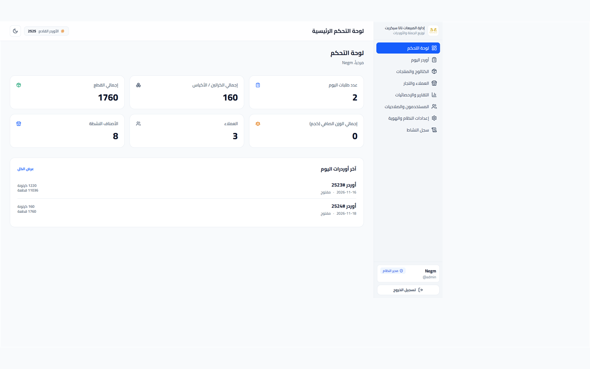
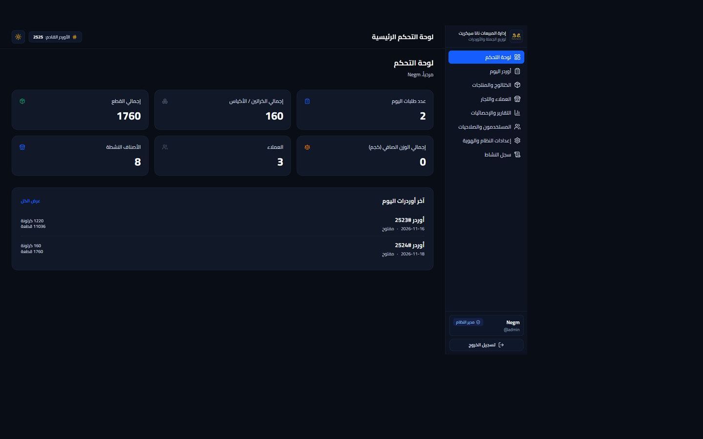
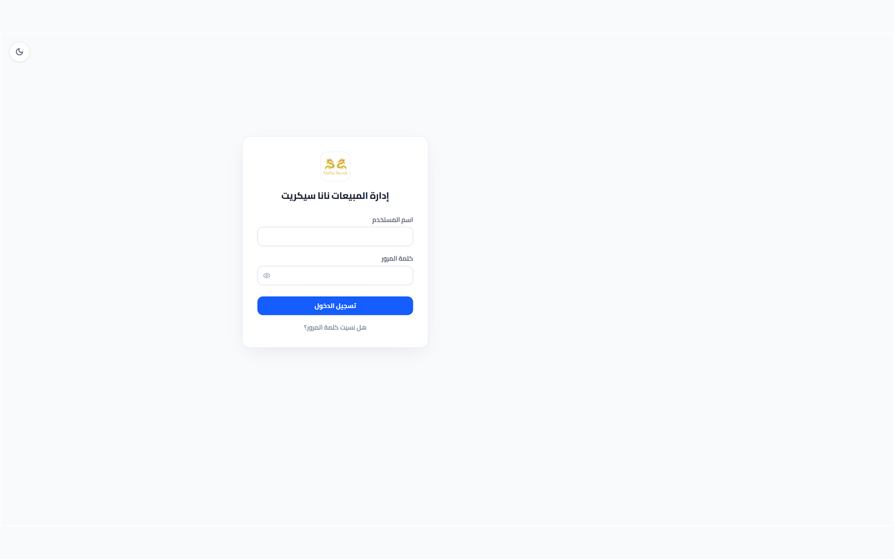
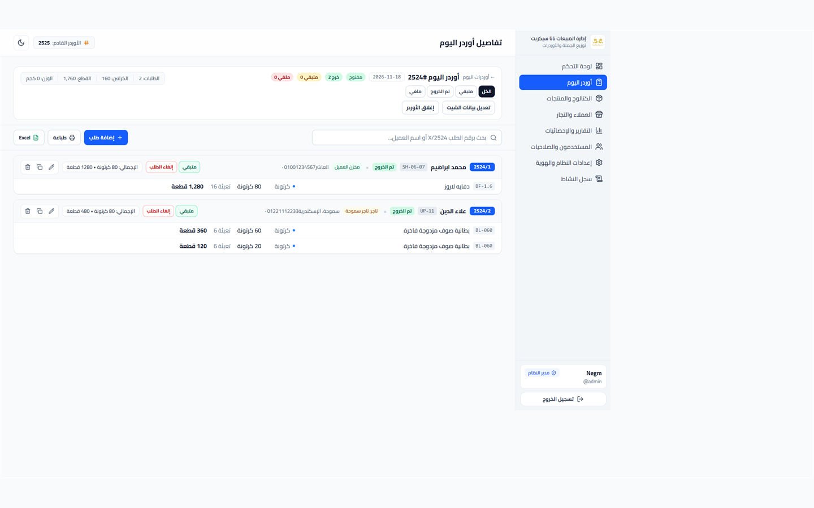
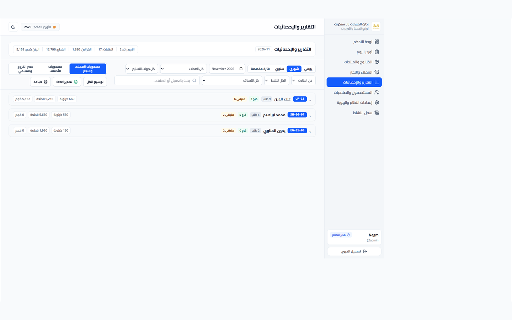
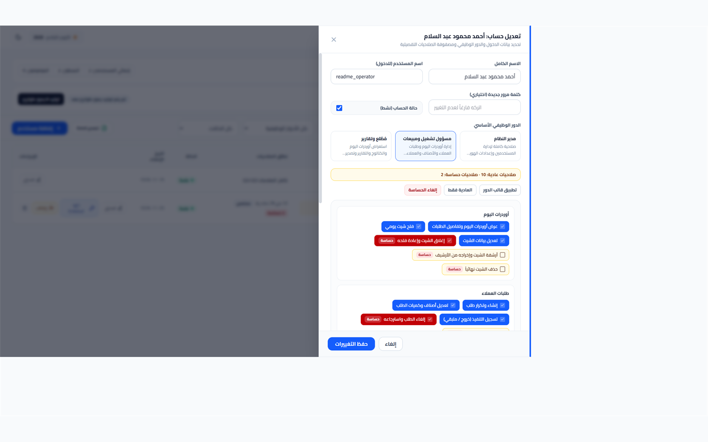
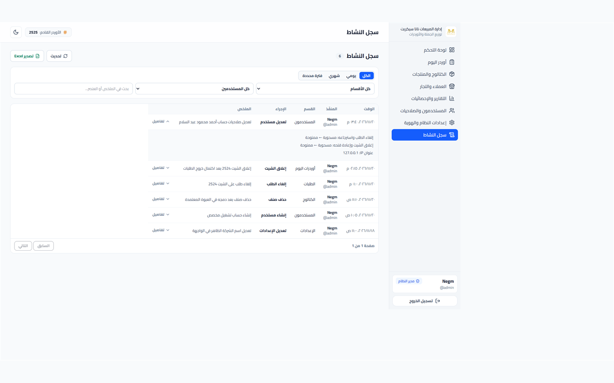

<h1 align="center">Sales Order</h1>

<p align="center">
  Arabic-first wholesale order desk for daily sheets, packaging-aware catalog, customers, reports, and governed operations.
</p>

<p align="center">
  <a href="https://workers.cloudflare.com/"></a>
  <a href="https://developers.cloudflare.com/d1/"></a>
  <a href="https://developers.cloudflare.com/r2/"></a>
  <a href="https://react.dev/"></a>
  <a href="https://www.typescriptlang.org/"></a>
  <a href="https://tailwindcss.com/"></a>
  <a href="https://orm.drizzle.team/"></a>
  <a href="https://github.com/exceljs/exceljs"></a>
</p>

<p align="center">
  <strong><a href="#-النسخة-العربية">العربية</a> | <a href="#-english-version">English</a></strong>
</p>

<a id="-english-version"></a>

## English Version

### Overview

Sales Order is the operating desk for Nana Secret wholesale distribution. Staff open a daily sheet, record customer orders in cartons, bags, pieces, or kilograms, and follow each order through dispatch, remainder, or cancellation. The interface is Arabic and right-to-left, with a light theme and a dark theme, and times in the audit log are shown in Africa/Cairo.

### Core capabilities

| Area | What the desk does |
| --- | --- |
| Daily sheets & orders | Open, close, reopen, archive, and review a numbered daily sheet. Orders carry the customer, delivery party, quantities, and fulfillment state. |
| Packaging-aware catalog | Products keep a loading type and a packing rule so carton and bag lines convert into pieces, while piece and kilogram lines stay direct. |
| Customers & sub-merchants | Each customer has a code, a default location, and optional sub-merchants used as delivery targets. |
| Reports, Excel, and print | Period filters roll totals up by customer, product, and fulfillment. Excel workbooks load on demand. A4 print layouts cover sheets and reports. |
| Bulk import | Catalog and customer workbooks can be checked, corrected, and imported without blocking the rest of the app. |

### Security & governance

- **Granular roles.** `admin`, `operator`, and `viewer` start from templates. A customized operator shows **مخصّص**, and every granted sensitive permission shows a **حساسة** count. Sensitive actions are enforced on the server.
- **Two recovery tracks.** An employee asks for a one-time recovery value that an administrator issues once. Administrators keep a separate emergency set. Those values are never written to the audit log.
- **Append-only audit log.** Successful sensitive changes are recorded with the actor, module, Arabic summary, and optional detail. The log is read-only: there is no edit, clear, or scheduled purge. Filters use Cairo day boundaries.
- **Login throttling.** Repeated failures are counted in D1 and answered with a wait period.
- **HTTP headers.** Responses send `Content-Security-Policy`, `X-Content-Type-Options: nosniff`, `X-Frame-Options: DENY`, `Referrer-Policy`, `Permissions-Policy`, and `Strict-Transport-Security` on HTTPS.

### Screenshots

Captured from the local desk at `http://127.0.0.1:8787`. No generated images.

| Light | Dark |
| --- | --- |
|  |  |

| Login | Daily sheet |
| --- | --- |
|  |  |

| Reports | Permissions | Audit log |
| --- | --- | --- |
|  |  |  |

### Architecture

```text
browser ── React 19 / Vite / Tailwind CSS 4
            │
            ▼
Cloudflare Worker (Hono)
   ├── D1        orders, catalog, users, audit log
   ├── R2        company logo and icon
   └── Assets    built SPA in dist/
```

| Path | Role |
| --- | --- |
| `src/client` | Pages, shell, print views, and lazy Excel export. |
| `src/worker` | HTTP routes, permission checks, audit writer, rate limit. |
| `src/shared` | Permissions, labels, order math, and audit copy used by both sides. |
| `src/db` | Drizzle schema and database bootstrap. |
| `migrations` | Numbered additive SQL migrations, `0000` through `0010`. |
| `scripts` | Production database backup and the out-of-band admin bootstrap. |

### Local setup

Requirements: Node.js 20+, npm, and Wrangler logged into the Cloudflare account that owns the D1 database.

```bash
npm install
copy .dev.vars.example .dev.vars
```

Set `<JWT_SECRET>` in `.dev.vars` to a long random value. Do not commit that file.

```bash
JWT_SECRET=<JWT_SECRET>
```

Apply the local migrations and start the desk:

```bash
npm run db:migrate:local
npm run dev:worker
```

Open `http://127.0.0.1:8787`. Create the first administrator with the bootstrap script on a machine that already holds `<JWT_SECRET>`. Do not paste sign-in values into the repository, issues, or screenshots.

Check types and the production bundle:

```bash
npm run typecheck
npm run build
```

Excel libraries stay out of the initial preload. Confirm `dist/index.html` does not preload `xlsx` or `exceljs`.

### Backup, migrations, and deploy

Before any remote migration, write a SQL backup:

```bash
npm run db:backup:production
```

Then apply remote migrations and deploy:

```bash
npm run db:migrate:remote
npm run deploy
```

`npm run deploy` typechecks, builds, and publishes the Worker. Keep production checks read-only after a release.

---

<a id="-النسخة-العربية"></a>

<div dir="rtl">

## النسخة العربية

### نظرة عامة

نظام أوامر البيع هو مكتب تشغيل جملة نانا سيكريت. يفتح الفريق شيت اليوم، ويسجّل طلبات العملاء بالكرتونة أو الكيس أو القطعة أو الكيلوجرام، ثم يتابع كل طلب حتى الخروج أو التبقي أو الإلغاء. الواجهة عربية ومن اليمين إلى اليسار، بوضع فاتح ووضع داكن، وأوقات سجل النشاط تُعرض بتوقيت القاهرة.

### القدرات الأساسية

| المجال | ماذا يفعل المكتب |
| --- | --- |
| أوردرات اليوم والطلبات | فتح الشيت وإغلاقه وإعادة فتحه وأرشفته. كل طلب يحمل العميل وجهة التسليم والكميات وحالة التنفيذ. |
| كتالوج يعرف التعبئة | كل صنف له نوع تحميل وقاعدة تعبئة، فتتحول الكراتين والأكياس إلى قطع، وتبقى القطعة والكيلوجرام كما أُدخلا. |
| العملاء والتجار الفرعيون | لكل عميل كود وموقع افتراضي وتجار فرعيون يمكن أن يكونوا جهة التسليم. |
| التقارير وExcel والطباعة | فلاتر الفترة تجمع الإجماليات حسب العميل والصنف وحالة الخروج. ملفات Excel تُحمَّل عند الطلب. الطباعة تغطي الشيت والتقارير بمقاس A4. |
| الاستيراد الجماعي | يمكن مراجعة ملفات الكتالوج والعملاء وتصحيحها ثم استيرادها دون إيقاف بقية المكتب. |

### الأمان والحوكمة

- **صلاحيات تفصيلية.** الأدوار `admin` و`operator` و`viewer` تبدأ من قوالب. الحساب المخصص يظهر عليه **مخصّص**، وكل صلاحية حساسة ممنوحة تُحسب في شارة **حساسة**. المنع يتم على الخادم.
- **مساران لاستعادة الدخول.** الموظف يطلب قيمة تُستخدم مرة واحدة ويصدرها المدير. للمدير مسار طوارئ منفصل. هذه القيم لا تُكتب في سجل النشاط.
- **سجل نشاط للإضافة فقط.** التغييرات الحساسة الناجحة تُحفظ مع المنفّذ والقسم وملخص عربي وتفصيل اختياري. السجل للقراءة فقط: لا تعديل ولا مسح ولا تنظيف مجدول. حدود اليوم تُحسب بتوقيت القاهرة.
- **تهدئة محاولات الدخول.** المحاولات المتكررة تُحسب في D1 ويُطلب الانتظار.
- **ترويسات HTTP.** الاستجابة تحمل `Content-Security-Policy` و`X-Content-Type-Options: nosniff` و`X-Frame-Options: DENY` و`Referrer-Policy` و`Permissions-Policy`، ومع HTTPS ترويسة `Strict-Transport-Security`.

### لقطات الشاشة

اُلتقطت من المكتب المحلي على `http://127.0.0.1:8787`. لا صور مولَّدة.

| الوضع الفاتح | الوضع الداكن |
| --- | --- |
|  |  |

| الدخول | أوردر اليوم |
| --- | --- |
|  |  |

| التقارير | الصلاحيات | سجل النشاط |
| --- | --- | --- |
|  |  |  |

### البنية

```text
المتصفح ── React 19 / Vite / Tailwind CSS 4
            │
            ▼
Cloudflare Worker (Hono)
   ├── D1        الطلبات والكتالوج والمستخدمون وسجل النشاط
   ├── R2        شعار الشركة وأيقونتها
   └── Assets    واجهة dist/
```

| المسار | الدور |
| --- | --- |
| `src/client` | الصفحات والهيكل والطباعة وتصدير Excel الكسول. |
| `src/worker` | مسارات HTTP وفحص الصلاحيات وكتابة السجل وتحديد المحاولات. |
| `src/shared` | الصلاحيات والتسميات وحساب الطلب ونصوص السجل المشتركة. |
| `src/db` | مخطط Drizzle وتهيئة القاعدة. |
| `migrations` | هجرات SQL إضافية مرقمة من `0000` إلى `0010`. |
| `scripts` | النسخ الاحتياطي لقاعدة الإنتاج وإنشاء المدير خارج المستودع. |

### التشغيل المحلي

المطلوب: Node.js 20+ وnpm وWrangler داخل حساب Cloudflare الذي يملك قاعدة D1.

```bash
npm install
copy .dev.vars.example .dev.vars
```

ضع `<JWT_SECRET>` في `.dev.vars` بقيمة عشوائية طويلة. لا ترفع هذا الملف.

```bash
JWT_SECRET=<JWT_SECRET>
```

طبّق الهجرات المحلية ثم شغّل المكتب:

```bash
npm run db:migrate:local
npm run dev:worker
```

افتح `http://127.0.0.1:8787`. يُنشأ أول مدير بأداة التهيئة على جهاز يحتفظ بـ `<JWT_SECRET>`. لا توضع قيم الدخول في المستودع أو في اللقطات.

فحص الأنواع والحزمة:

```bash
npm run typecheck
npm run build
```

مكتبات Excel تبقى خارج التحميل الأول. تأكد أن `dist/index.html` لا يحمّل `xlsx` أو `exceljs` مسبقًا.

### النسخ الاحتياطي والهجرة والنشر

قبل أي هجرة بعيدة، اكتب نسخة SQL:

```bash
npm run db:backup:production
```

ثم الهجرة البعيدة والنشر:

```bash
npm run db:migrate:remote
npm run deploy
```

الأمر `npm run deploy` يفحص الأنواع ويبني ثم ينشر العامل. فحوصات الإنتاج بعد النشر تبقى للقراءة فقط.

</div>
